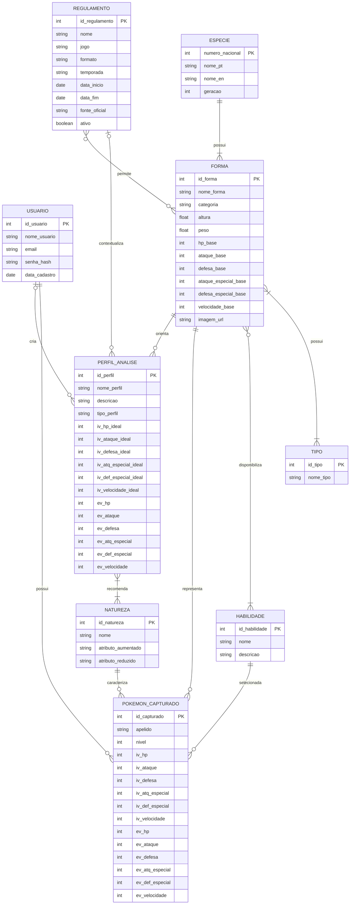

# Diagrama Entidade-Relacionamento

Este diagrama é a representação visual inicial do modelo conceitual. Ele usa a sintaxe ER do Mermaid para ficar versionado em texto e poder ser visualizado diretamente no GitHub.

## Observações

- `||--o{` representa um lado obrigatório e único ligado a zero ou muitos registros do outro lado.
- `}|--|{` representa uma relação de muitos para muitos em que cada lado participa de pelo menos um relacionamento no catálogo.
- Os relacionamentos opcionais de PERFIL_ANALISE com USUARIO e REGULAMENTO representam os perfis que podem ser mantidos pelo sistema e os perfis personalizados.
- Limites como "uma forma pode ter no máximo dois tipos" não são expressos completamente pela notação do diagrama; são regras de negócio.
- Este é um DER conceitual inicial. O modelo lógico ainda deverá converter as relações N:N em estruturas apropriadas e definir as chaves estrangeiras.
