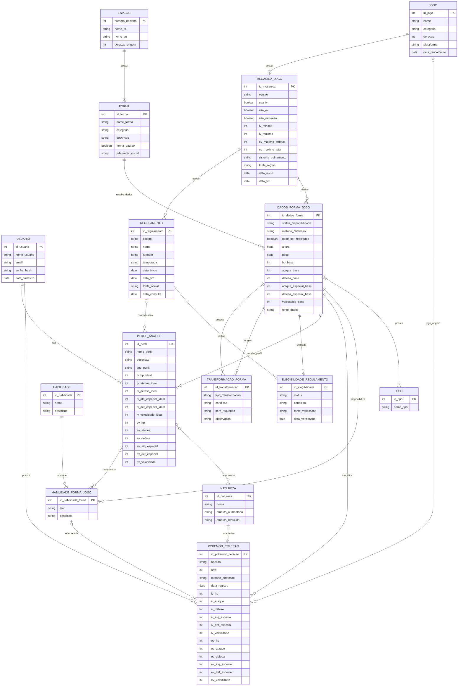

# Diagrama Entidade-Relacionamento

**Versão:** 2.0  
**Status:** modelo conceitual revisado

O diagrama separa o catálogo global, os dados por jogo, a coleção dos usuários e a elegibilidade competitiva.

## Como interpretar

- ESPECIE e FORMA descrevem o catálogo global.
- DADOS_FORMA_JOGO guarda estatísticas, tipos, habilidades e disponibilidade no contexto de um jogo/mecânica.
- MECANICA_JOGO registra quais sistemas e limites se aplicam.
- POKEMON_COLECAO guarda um exemplar sem presumir que todos os jogos utilizem captura, IV ou EV.
- PERFIL_ANALISE aponta para uma forma em um contexto específico.
- REGULAMENTO e ELEGIBILIDADE_REGULAMENTO separam a presença na Pokédex da permissão competitiva.
- TRANSFORMACAO_FORMA liga a forma original à forma transformada.

## Regras importantes

1. Campos de IV/EV podem ser nulos quando não se aplicarem; nulo não equivale a zero.
2. Uma forma catalogada não precisa estar disponível em todos os jogos.
3. Uma forma transformada não é automaticamente uma captura independente.
4. Uma habilidade selecionada precisa estar disponível para a forma no jogo.
5. A legalidade é verificada por regulamento.
6. Uma forma não verificada não deve ser declarada proibida.
7. Relações N:N serão convertidas em tabelas associativas no modelo lógico.

Este DER substitui a versão conceitual anterior. Ele ainda deverá ser desenhado e conferido visualmente no brModelo antes da aprovação final.
