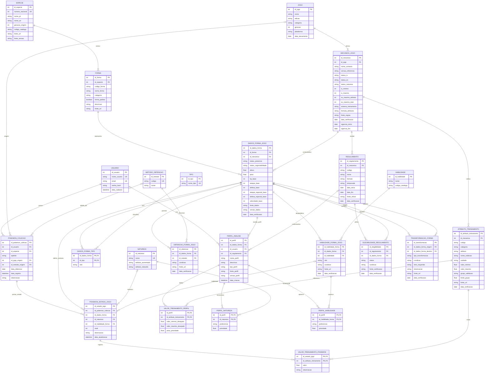

# Diagrama Entidade-Relacionamento — PokéAnalyzer

**Versão:** 3.0  
**Status:** DER textual corrigido; ainda precisa ser reproduzido e conferido no brModelo.

O diagrama separa catálogo, contexto de jogo, exemplar individual, estado por jogo, treinamento, perfil e regulamento.

## Como interpretar

- ESPECIE e FORMA compõem o catálogo global.
- MECANICA_JOGO identifica regras documentadas de um jogo; não representa uma temporada competitiva.
- DADOS_FORMA_JOGO contextualiza atributos, tipos, habilidades, presença e registrabilidade.
- OBTENCAO_FORMA_JOGO aceita vários métodos para a mesma forma/contexto.
- POKEMON_COLECAO representa o exemplar do usuário; POKEMON_ESTADO_JOGO guarda o estado dele em cada jogo.
- ATRIBUTO_TREINAMENTO e VALOR_TREINAMENTO_POKEMON evitam fixar IV/EV como campos universais.
- PERFIL_ANALISE é uma referência de comparação; REGULAMENTO é uma regra de competição.
- ELEGIBILIDADE_REGULAMENTO trata da forma, não da legalidade integral do exemplar.
- TRANSFORMACAO_FORMA liga contextos de origem e destino sem criar um novo exemplar automaticamente.

## Restrições que precisam aparecer no modelo lógico

O Mermaid comunica entidades e relações, mas não expressa todas as regras:
1. combinação FORMA + MECANICA_JOGO única em DADOS_FORMA_JOGO;
2. no máximo dois tipos e slots distintos por contexto;
3. habilidade selecionada vinculada ao mesmo DADOS_FORMA_JOGO;
4. atributo de treinamento do mesmo MECANICA_JOGO do estado;
5. perfil compatível com a mesma forma/mecânica;
6. regulamento e forma pertencentes ao mesmo contexto;
7. origem e destino de transformação no mesmo contexto;
8. limites agregados de treinamento;
9. estado em jogo só quando a forma puder ser registrada independentemente.

Essas regras estão descritas em [regras-integridade.md](regras-integridade.md). O DER visual ainda deve ser conferido no brModelo.
