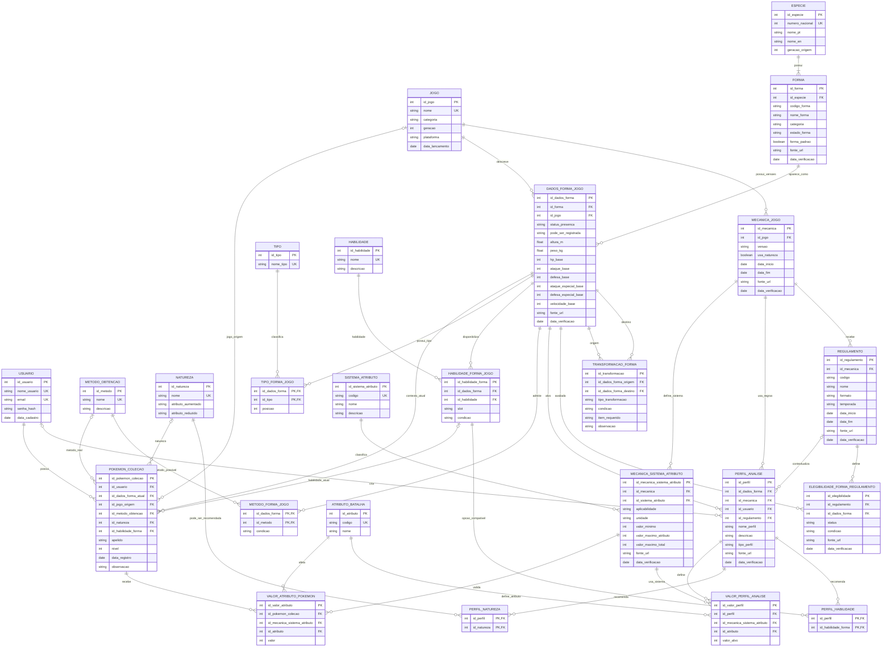

# Diagrama Entidade-Relacionamento — versão 3.0

**Status:** DER textual proposto após auditoria.  
**Referência conceitual:** [modelo-conceitual-v3.md](modelo-conceitual-v3.md)

Este DER separa catálogo, dados por jogo, mecânicas versionadas, exemplares individuais, valores de atributos, perfis e regulamentos. Ele ainda precisa ser desenhado e conferido no brModelo.

## Restrições que não ficam totalmente visíveis no desenho

1. Uma forma pertence a uma espécie; codigo_forma é único dentro da espécie.
2. Deve existir exatamente uma forma padrão por espécie.
3. A combinação forma + jogo é única em DADOS_FORMA_JOGO.
4. TIPO_FORMA_JOGO aceita somente posição 1 ou 2, sem repetir tipo ou posição; no máximo duas linhas por ficha.
5. A combinação ficha + habilidade + slot é única.
6. A combinação ficha + método é única.
7. A combinação jogo + versão de mecânica é única.
8. A combinação mecânica + sistema de valores de atributo é única.
9. A combinação exemplar + sistema de valores de atributo + atributo é única.
10. A combinação perfil + sistema de valores de atributo + atributo é única.
11. Perfil personalizado exige usuário; perfil de referência é mantido pelo sistema.
12. Forma e mecânica de perfil devem pertencer ao mesmo jogo.
13. Elegibilidade é única por regulamento + ficha da forma.
14. Uma transformação deve ligar duas fichas do mesmo jogo.
15. Valores e limites não confirmados não devem ser presumidos.

**Atenção:** Mermaid é uma representação documental. A cardinalidade, obrigatoriedade e as restrições acima precisam ser reproduzidas e conferidas no brModelo e depois no modelo lógico.

## Semântica da camada de valores de atributos

Os nomes SISTEMA_ATRIBUTO, MECANICA_SISTEMA_ATRIBUTO e VALOR_ATRIBUTO_POKEMON são intencionais: IV não é treinamento. O modelo agrupa sistemas que fornecem valores de atributos sem declarar que todos funcionam da mesma forma.
